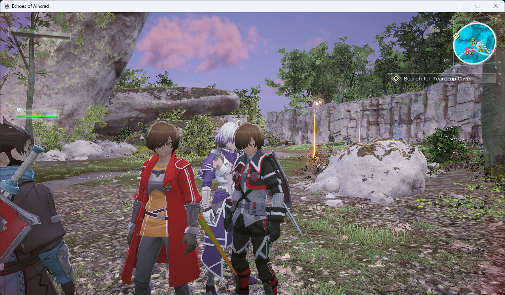
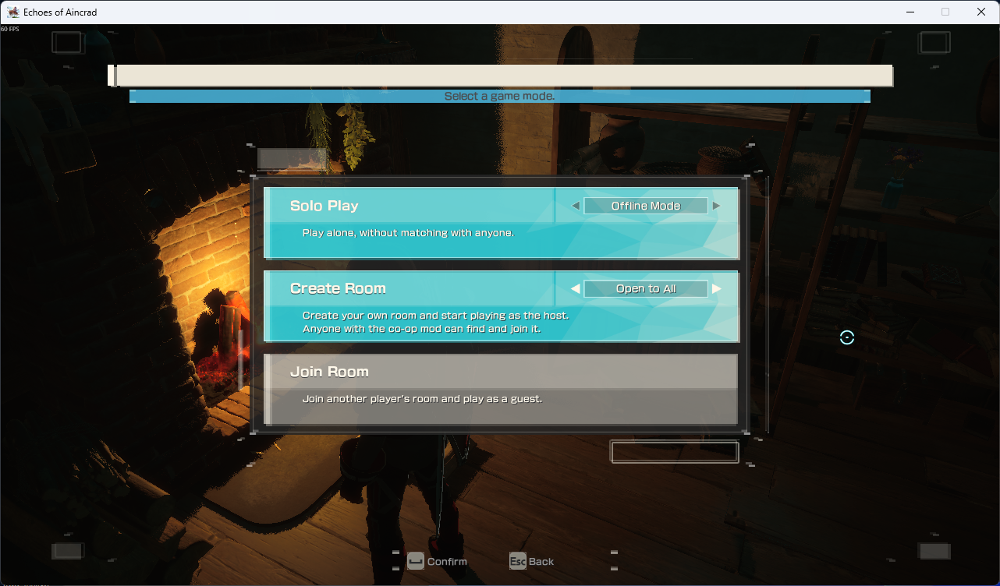
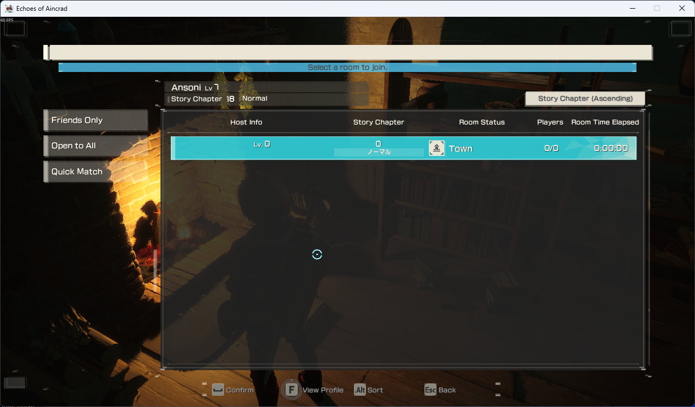
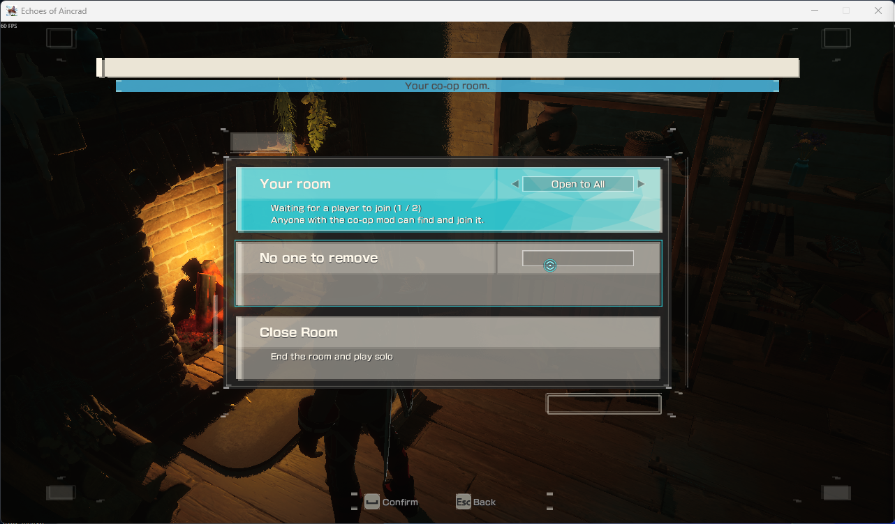
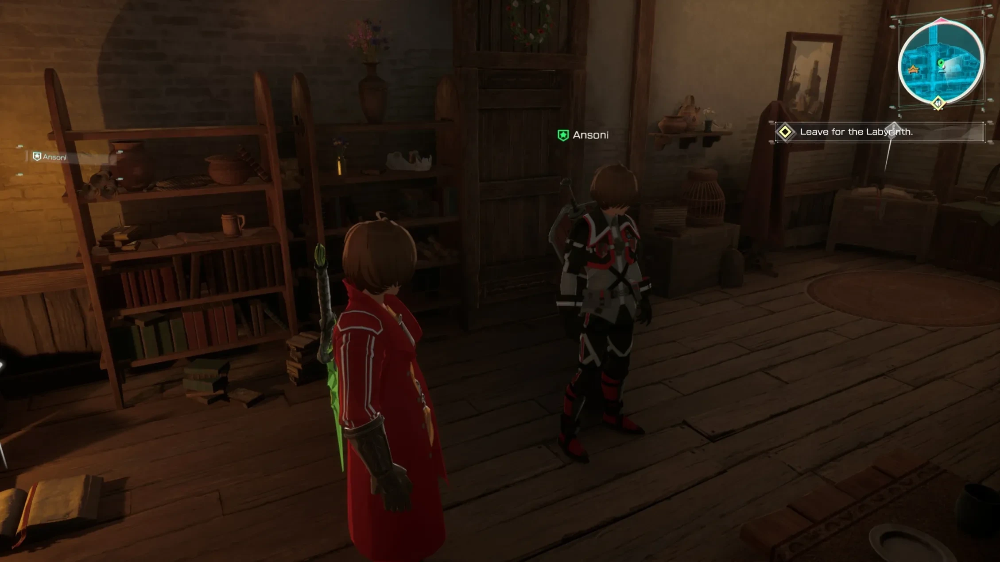

<div align="center">

# ⚔️ Echoes of Aincrad Co-op

**Two-player co-op for *Echoes of Aincrad* — over Steam or your local network.**




[Features](#-features) · [Install](#-install) · [Play](#-play) · [Build](#-build-the-player-package) · [Develop](#-develop)

</div>

---

The game ships as single player with its multiplayer switched off. This mod runs one copy of the game per player
and keeps the two in step: the other player walks your world as a living ghost, the host's enemies fight you both,
loot drops for both of you, and when the host sets off on a quest, the guest goes along.

> [!NOTE]
> Experimental. Played by two people over Steam and tested with two copies on one PC.

## ✨ Features

| | |
|---|---|
| 📖 **Multiplayer book** | A book by the fireplace in the Town of Beginnings bedroom opens the game's own hidden menus: *Solo Play*, *Create Room*, *Join Room*. |
| 🌐 **Rooms** | *Friends Only* and *Open to All* rooms are Steam lobbies on Steam's relay — no ports to open. *LAN* rooms work on the same network or two copies on one PC. |
| 🔎 **Room browser** | The game's own Room Select screen, filled with real rooms: host, level, story chapter, players. |
| 🛡️ **Host controls** | Switch the room's privacy, remove the other player, close the room. |
| 👥 **The other player** | Their hero as a ghost wearing their own gear and look, with a name plate, an HP gauge and a minimap marker. |
| 🐗 **Enemies** | The host's enemies are the real ones; the guest fights puppets that move and attack the same way. Damage, hit reactions and deaths go both ways. |
| 💎 **Loot** | Every drop for both players (*share*), or first come, first served (*steal*). |
| ❤️ **Revive** | A downed player can be picked back up by the other. |
| 🗺️ **Quests** | The host picks; the guest follows into the same quest automatically — even when joining later. |
| ⚡ **F8** | Teleport next to the other player. |

## 📸 Screenshots

| Multiplayer book | Joining a room | Hosting a room |
|:---:|:---:|:---:|
|  |  |  |

<p align="center">
  
  <br><sub>The other player's hero in the bedroom, with its name plate and HP gauge</sub>
</p>

## 📦 Install

1. Get the player package zip (see [Build](#-build-the-player-package)).
2. In Steam: right-click **Echoes of Aincrad** → **Manage** → **Browse local files**.
3. Extract the zip into that folder, so its `EchoesofAincrad` folder merges with the game's.
4. Start the game from Steam as normal.

> [!IMPORTANT]
> `dwmapi.dll` must end up right next to `EchoesofAincrad\Binaries\Win64\EchoesofAincrad-Win64-Shipping.exe`.
> Windows' **Extract All** adds an extra folder named after the zip — extract into the game folder itself.

> [!TIP]
> If Windows asks whether Python may use the network, allow it — LAN rooms need it.

## 🎮 Play

| | Host | Guest |
|---|---|---|
| **1** | Go to the book in the Town of Beginnings bedroom | Go to the book in the Town of Beginnings bedroom |
| **2** | **Create Room** — left / right picks *Friends Only*, *Open to All* or *LAN* | **Join Room** — pick a list on the left, then the room |
| **3** | Pick a quest at the main terminal | Follow along automatically |

- Each player needs their own Steam account and copy of the game. Two copies on one Steam account can't join each
  other's Steam rooms — use a **LAN** room for that.
- A game that has just started is always solo; rooms are made and joined at the book.
- Loot mode is the host's `coop_loot.txt`: `share` or `steal`.

## 📦 Build the player package

```powershell
python\python.exe tools\make_package.py [out.zip]
```

Packs UE4SS (from this install), the mod and its embedded Python into a zip that extracts straight into the game
folder. With no argument it writes `EchoesOfAincrad_Coop.zip` to the Desktop. Development files — `tools/`, `docs/`,
this README, `remote.txt`, `autoexec.txt` — stay out.

## 🛠️ Develop

<details>
<summary><b>Project layout</b></summary>

<br>

| Path | What it is |
|---|---|
| `Scripts/main.lua` | UE4SS entry point: logging, startup, loads `coop.lua` |
| `coop.lua` | The sync loop: writes this player's state, reads the other player's, drives the rest |
| `ghost2.lua` | The other player's ghost — look, animation, montages |
| `enemies.lua` | Host-authority enemy sync and the guest's puppets |
| `proxy.lua` | The guest's invisible stand-in on the host, which the host's enemies target |
| `loot.lua` | Drop sync (share / steal) |
| `revive.lua` | Downed, revive and safe zones |
| `hud.lua` | The other player's HP gauge, name plate and minimap marker |
| `party.lua` | AI companions — only the host's story party is kept |
| `lobby.lua` | The book, its menus, rooms and the room browser |
| `quests.lua` | Host-only quest picking and the guest's quest follow |
| `coop_steam.py` | The Steam helper: lobbies, relay traffic, LAN rooms (runs on the embedded Python) |
| `coop_link.py` | The older plain-UDP link (`coop_transport.txt` = `link`) |
| `coop_transport.txt` · `coop_loot.txt` | Settings: transport (`steam`) and loot mode (`share` / `steal`) |
| `launch_*.bat/.ps1` · `stop_steam_helpers.bat` | Launch and clean-up helpers |
| `tools/make_package.py` | Builds the player zip |
| `tools/dev/` | Development helpers |
| `docs/screenshots/` | The screenshots in this README |

The embedded Python (`python/`) and everything the mod writes while it runs — logs, link and status files — are
kept out of the repository.

</details>

<details>
<summary><b>Logs and remote Lua</b></summary>

<br>

- Each game writes `netdebug_<date>_<time>_<tag>.log` in this folder; UE4SS's own log is `ue4ss\UE4SS.log`.
- With a `remote.txt` file in this folder, run Lua inside a running game:

  ```powershell
  python\python.exe tools\dev\send.py <tag> "lua return Coop.Status()"
  python\python.exe tools\dev\send.py <tag> "luafile ue4ss/Mods/NetDebug/coop.lua"
  ```

</details>

<details>
<summary><b>Two copies on one PC</b></summary>

<br>

`tools/dev/launch_copy1.ps1` and `launch_copy2.ps1` start the copies side by side — copy 2 with its own save folder
(`-userdir=...EchoesofAincrad_P2`). An `autoexec.txt` of console commands keeps the pair light: 720p window, 30 fps
cap, lower settings.

</details>

<details>
<summary><b>Testing helpers</b></summary>

<br>

Run through `send.py` (`"lua <settings>` + the file's contents):

| Helper | Does |
|---|---|
| `spawn_boss.lua` | Spawns any enemy through the game's own spawner — `BOSS_PATH`, `BOSS_LEVEL`, `BOSS_FORCE_LEVEL` (past the area's level cap), `BOSS_HP`, `BOSS_DIST` |
| `kill_class.lua` | Kills every live enemy of a class |
| `tp_terminal.lua` | Teleports to the Town of Beginnings main terminal |
| `list_enemies.lua` | Lists every enemy class in the game |
| `snapdump.py` | Minidump of a frozen copy |
| `snap.ps1` · `sendkey.ps1` | Screenshot / key press to a game window |

</details>

> [!WARNING]
> **Rules learned the hard way** — the code follows them:
> - **No Lua off the game thread.** `RegisterKeyBind`, `LoopAsync`, `ExecuteWithDelay` and `NotifyOnNewObject` run
>   their callbacks on other threads, and Lua run there alongside the game thread's crashes the game. Use
>   `LoopInGameThreadAfterFrames`, and read keys with `IsInputKeyDown`.
> - **No `FindAllOf` on a timer** — nor `UEHelpers.GetPlayerController()` / `GetWorld()`, which use it. Each walks
>   every object in the game: ~35 ms a call on a fast PC, far more on a slow one. Use `Coop.LocalPC()` and the
>   game's own lists (`GameState.RODEnemies`, `RODAccessibleGimmicks`, the gimmick manager's drop lists).
> - **Don't keep game objects across map changes.** A freed object's address gets reused and `IsValid()` still
>   says yes — for a different object. Key anything kept by the map's GameState name; check kept assets by path.

## 🚧 Known limitations

- The book only exists in the Town of Beginnings bedroom; a save that starts elsewhere (e.g. Tolbana) has to travel
  there first.
- Two players only.
- Enemies made by the game's spawner are capped at the area's level.
